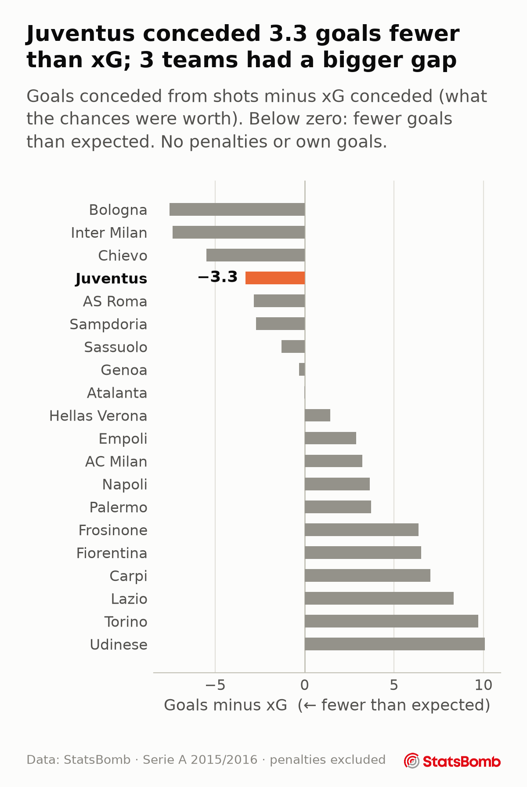
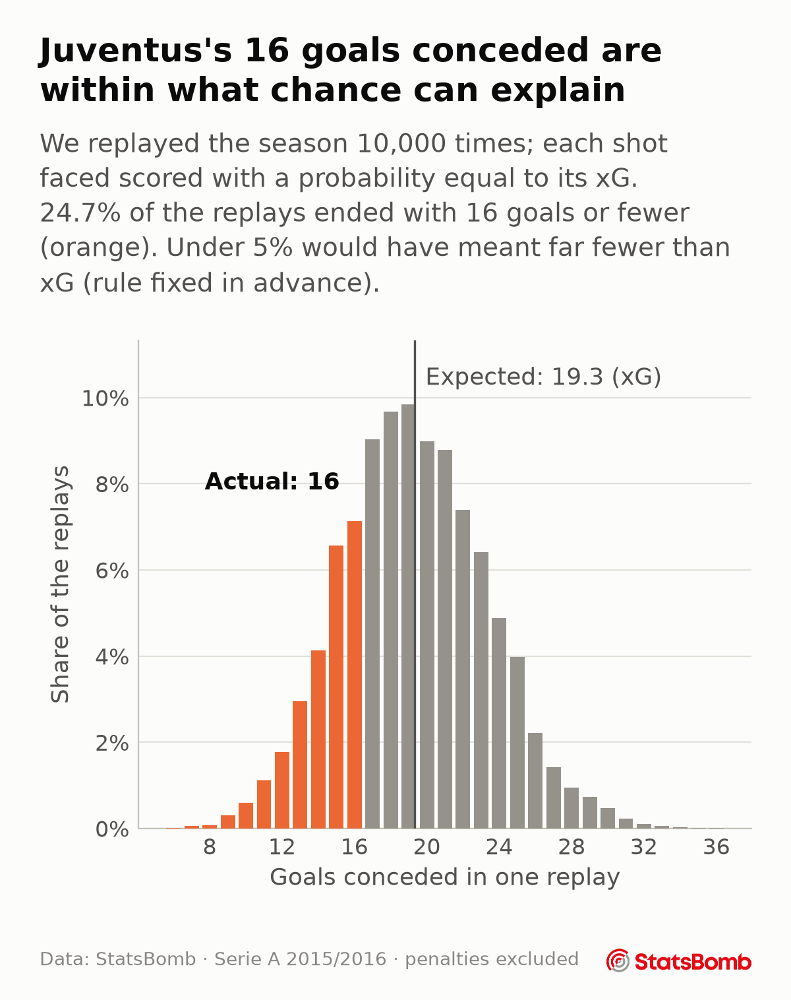

<!-- Written by src/05_report.py from templates/readme.template.md. Do not edit this file: edit the template, then run run_all.py. -->
# Why did Juventus concede so few goals? Serie A 2015/16

Juventus conceded only 20 goals in 38 league matches in 2015/16, the fewest of the 20 teams (Napoli were next, with 32). This project asks why, with StatsBomb's free event data for all 380 matches of the season.

**Short answer.** Juventus allowed the weakest chances in the league, and almost the fewest shots. Their goals conceded are within what chance can explain, so luck is not needed to explain their record.

**One-page summary:** [English](docs/summary_en.md) ([PDF](docs/summary_en.pdf)) · [Japanese](docs/summary_ja.md) ([PDF](docs/summary_ja.pdf))


## Question and hypothesis

- **Question:** Why did Juventus concede so few goals?
- **Hypothesis**, written before any analysis: Juventus allowed the fewest and the weakest chances in the league, and their goals conceded were about what xG predicted. So the main reason was how they defended, not their goalkeeper or luck.

> **xG (expected goals):** for each shot, the chance that it becomes a goal, from StatsBomb's model (based on many similar past shots). A team's xG conceded is the sum over all the shots it faced.

The rules for judging each part of the hypothesis were fixed and committed before any result was calculated: see [the rules in PLAN.md](PLAN.md#6-analysis-rules-fixed-on-2026-11-18-before-any-result-was-calculated) and commit [`ada634d`](https://github.com/takakuwa-mamada/juventus-defence-2015-16/commit/ada634db4f19c5ba55dfc3bf216a6a9ed6b2d269). All 20 teams are measured in the same way, from the shots of their opponents. Penalties are left out of the main numbers, and own goals are counted separately.

## What I found

**The weakest chances: supported.** The average shot against Juventus had a 5.6% chance of going in (its xG), the lowest of the 20 teams. Together with the small number of shots, this gave Juventus the lowest xG conceded per match: 0.51.

**The fewest chances: not supported, but close.** Juventus faced 9.1 shots per match, the 2nd fewest. Napoli faced 2 shots fewer in the whole season (9.0 per match), but more dangerous ones: a 7.1% chance per shot. The rule asked for first place, so this part of the hypothesis is not supported.

**Goals about what xG predicted: consistent with the data.** Juventus conceded 16 goals from non-penalty shots, while the chances they allowed were worth 19.3 xG: 3.3 goals fewer than expected (3 teams had a bigger gap). To see whether a gap like this could be chance, the season was replayed 10,000 times: in each replay, every shot that Juventus faced became a goal with a probability equal to its xG. 24.7% of the replays ended with 16 goals or fewer. Under 5% would have meant "far fewer goals than xG", so the gap is within what chance can explain. With penalties included, the result is the same (24.5% of the replays).

**Possession: it explains part of the low numbers.** A team that keeps the ball gives its opponents fewer chances to attack. So the shots and xG conceded were also counted per 100 opponent possessions (a possession is one spell of play by one team, however short). On this scale, Juventus is 3rd on shots and 1st on xG. The rule fixed in advance says that possession explains part of the low numbers unless Juventus is first on both.

All the results: [`results/hypothesis_tests.csv`](results/hypothesis_tests.csv) (the tests) and [`results/team_metrics.csv`](results/team_metrics.csv) (every measure for every team).

## The other two charts





## So what

> Judge a defence by the quality of the chances it allows, not only by how many shots or goals it concedes.
>
> Before explaining a headline number, break it into its drivers: Juventus's record came from very few shots and the weakest chances in the league, and luck is not needed to explain it.

## How the data was checked

Before any analysis, the data passed all 9 checks below ([`results/data_checks.csv`](results/data_checks.csv)). They check StatsBomb's data against itself (for example, the goals in the events add up to the final score of every match) and against the official league table, typed in from two public sources ([`reference/`](reference/)). If a check fails, `run_all.py` stops before the analysis.

| Check | What is checked | Result |
|---|---|---|
| 1 | Serie A 2015/2016 is found by name in competitions.json, exactly once | passed: competition_id=12, season_id=27 |
| 2 | 380 matches, 20 teams, 38 matches per team, and every team meets every other team once at home and once away | passed: 380 matches, 20 teams, 38 to 38 matches per team, every home-away pair once |
| 3 | every match has an events file with events in it, and no match appears twice | passed: 380 matches, 0 repeated; events per match: 2850 to 4597 |
| 4 | goals counted from the events (shots + own goals) = the final score, in every match | passed: 380 of 380 matches agree; all goals: 979 from the events, 979 from the scores |
| 5a | each typed-in final table adds up (for example, total goals scored = total goals conceded) | passed: both tables add up |
| 5b | the Lega Serie A table and the RSSSF table agree on every number | passed: all 20 teams agree on 7 columns |
| 5c | the league table rebuilt from StatsBomb's final scores = the official Lega Serie A table | passed: all 20 teams agree on 7 columns |
| 6 | every shot has an xG value between 0 and 1 | passed: 9998 shots, 0 without a valid xG; xG from 0.000 to 0.966 |
| 7 | Juventus's goals conceded counted from the events = the official table | passed: 20 from the events, 20 in the official table |

## Limitations

- **One season, one data provider.** xG comes from StatsBomb's model, not mine.
- **"Within chance" is not proof of no luck.** One season is short: the replay would have called the goals "far fewer than xG" only if Juventus had conceded 12 or fewer.
- **The goalkeeper's part and luck cannot be fully separated.** xG measures the chance at the moment of the shot, not how well the shot was struck.
- **Possessions are counted, not timed.** Every possession counts once, however short. This is not the share of time on the ball.
- **Event data only.** The data shows what happened on the ball. It shows where the other players were only when a shot was taken, and not always for every player.

## How to rerun

You need Python `3.12`. The data download is about 1.2 GB. In Windows PowerShell, from the project folder:

```powershell
py -3.12 -m venv .venv
.venv\Scripts\python -m pip install -r requirements.txt
.venv\Scripts\python run_all.py
```

`run_all.py` runs the steps in [`src/`](src/) in order: it downloads 382 files from one fixed version (commit) of StatsBomb's open data, checks them, calculates the measures, draws the charts, writes this README and the one-page summaries, and prints the summaries to PDF. The last step needs Microsoft Edge or Google Chrome; without them, it is skipped. A second run gives exactly the same tables, charts and text, byte for byte, and leaves the PDFs as they are. The tests of the key calculations: `.venv\Scripts\python -m pytest`.

## How this was built

The code was written with an AI coding assistant (Claude Code). The question, hypothesis, data checks, chart choices and interpretation are mine. Every decision is logged in [DECISIONS.md](DECISIONS.md), with the options I considered and the reason for my choice.

## Files

| Path | What it is |
|---|---|
| [`run_all.py`](run_all.py) | runs every step, in order |
| [`src/`](src/) | the steps: download, data checks, measures, charts, text, PDFs |
| [`templates/`](templates/) | the text of this README and of the summaries, with a placeholder for every number |
| [`results/`](results/) | the tables and charts written by the steps |
| [`reference/`](reference/) | the official final table, typed in from two public sources |
| [`docs/`](docs/) | the one-page summaries (Markdown and PDF), and a summary of StatsBomb's terms |
| [`tests/`](tests/) | tests of the key calculations |
| [`PLAN.md`](PLAN.md), [`DECISIONS.md`](DECISIONS.md) | the plan, and every decision with its options and reason |

## Data

**Data: StatsBomb.** This project uses StatsBomb's free open data, under the StatsBomb Public Data User Agreement ([my summary of the terms](docs/statsbomb_terms.md)). The raw data is not in this repository: `run_all.py` downloads it.


