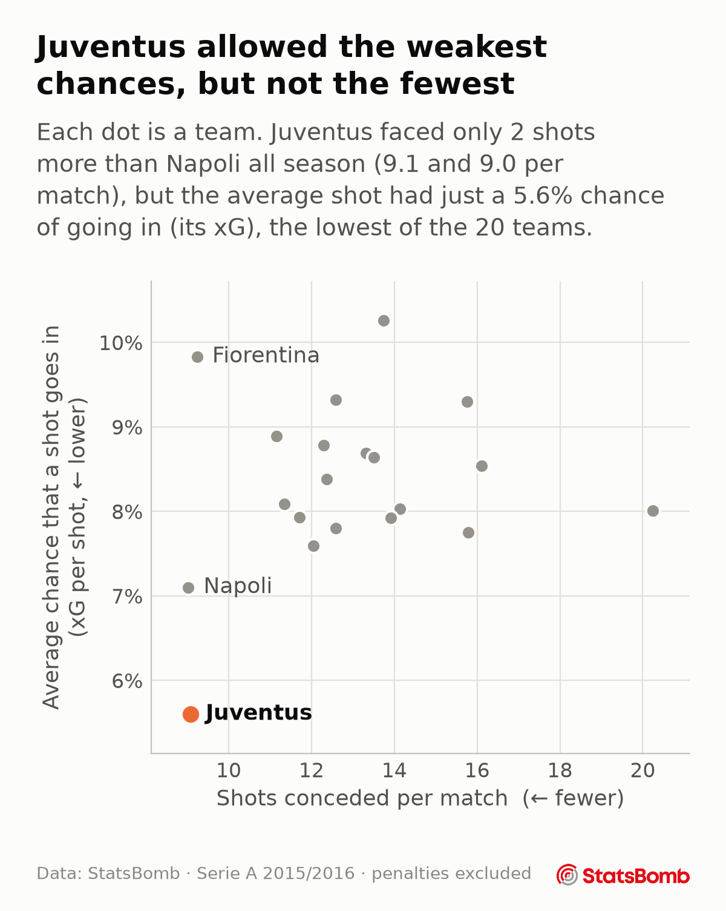
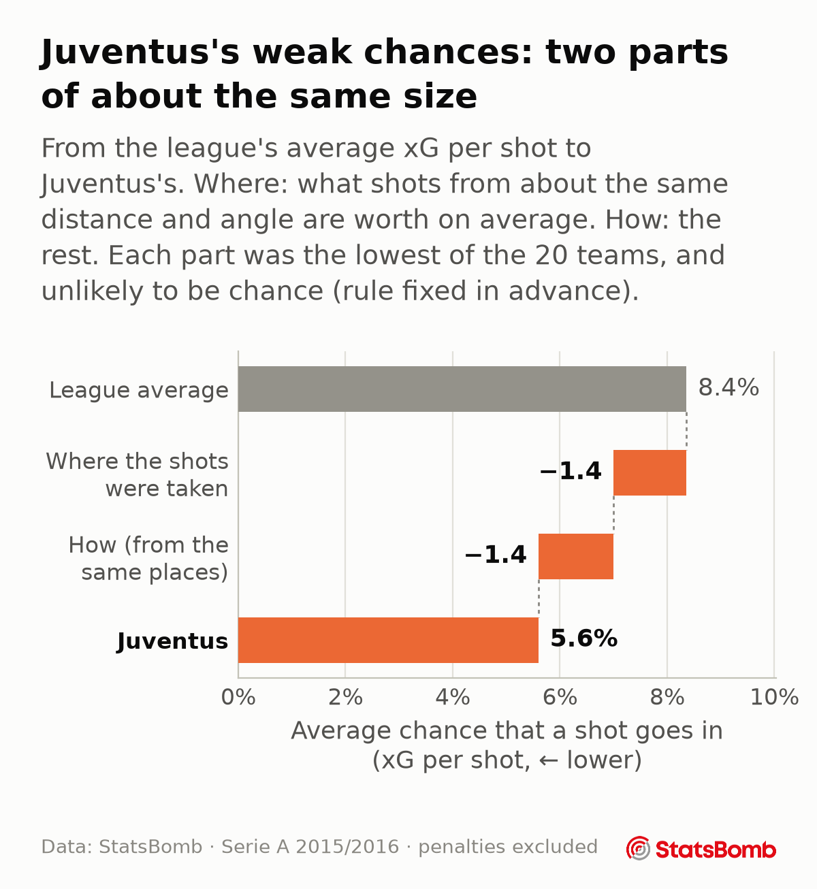

<!-- Written by src/05_report.py from templates/summary_en.template.md. Do not edit this file: edit the template, then run run_all.py. -->
# Why did Juventus concede so few goals?

Serie A 2015/16 · Masaki Takakuwa · Data: StatsBomb

**Question.** Juventus conceded only 20 goals in 38 league matches, the fewest of the 20 teams. Why?

**Hypothesis**, written before the analysis: they allowed the fewest and the weakest chances, and their goals conceded were about what xG predicted. So the reason was how they defended, not their goalkeeper or luck. *(xG, expected goals: for each shot, the chance that it becomes a goal, from StatsBomb's model.)*

**What the data shows** (all 380 matches; the rules were fixed before the results)

- **The weakest chances: supported.** The average shot against Juventus had a 5.6% chance of going in, the lowest of the 20 teams.
- **The fewest chances: not supported, but close.** 9.1 shots per match, the 2nd fewest. Napoli faced 2 shots fewer all season, but more dangerous ones (7.1% per shot).
- **Goals about what xG predicted: consistent.** 16 goals from non-penalty shots, against 19.3 xG. In 10,000 replays of the season, 24.7% ended with as few goals or fewer: within what chance can explain.
- **Possession explains part.** Counted per 100 opponent possessions, Juventus is 3rd on shots and 1st on xG.
- **One level deeper: where and how, about half each.** The opponents shot from worse places than the league's average (1.4 points below 8.4%) and, from the same places, their shots were still weaker (1.4 less). Both parts were the lowest of the 20 teams and unlikely to be chance. More defenders in the way do not explain it (15th of 20).

 

**So what.** Judge a defence by the quality of the chances it allows, not only by how many shots or goals it concedes. Before explaining a headline number, break it into its drivers: Juventus's record came from very few shots and the weakest chances in the league, and luck is not needed to explain it.

**How it was checked.** Before the analysis, the data passed all 9 checks: for example, the goals in the events add up to the final score of every match, and the league table rebuilt from the data matches the official one.

**Limits.** One season and one data provider (xG is StatsBomb's model). "Within chance" is not proof of no luck. Event data shows where the other players were only when a shot was taken. The how part is everything that is not the place, not only how Juventus defended; headers, pressure and the kind of the last pass explain only 9% of it (I expected 67% or more).

Code, data checks and every decision: [github.com/takakuwa-mamada/juventus-defence-2015-16](https://github.com/takakuwa-mamada/juventus-defence-2015-16). The code was written with an AI coding assistant (Claude Code); the question, hypothesis, data checks, chart choices and interpretation are mine.

