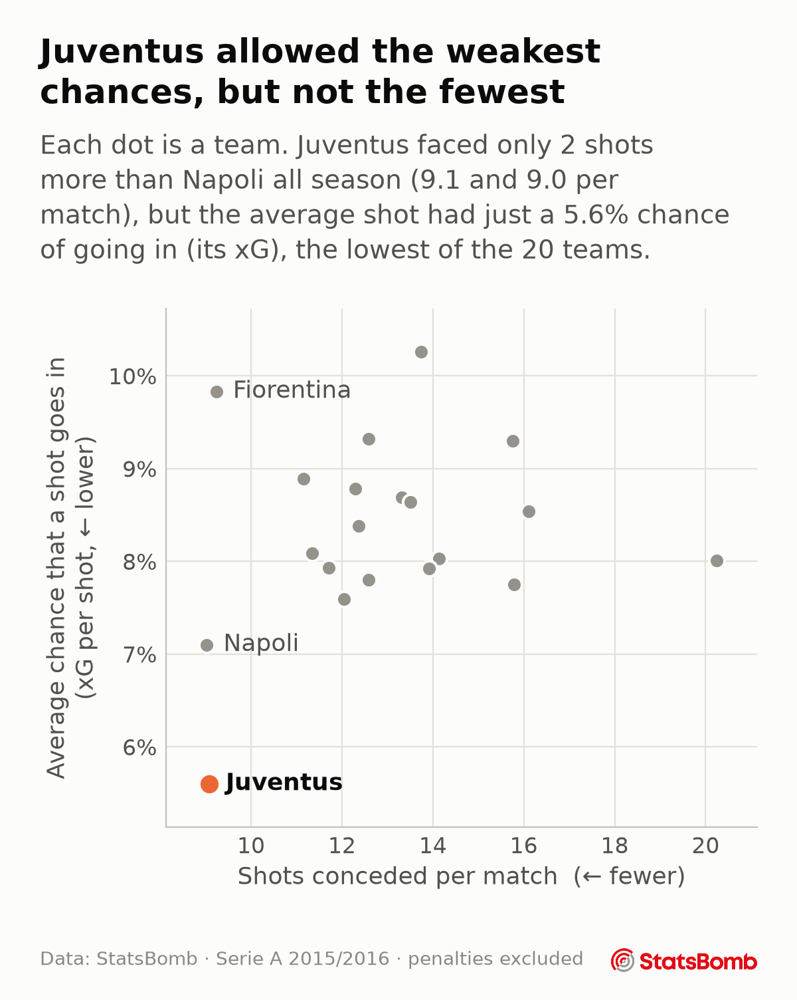
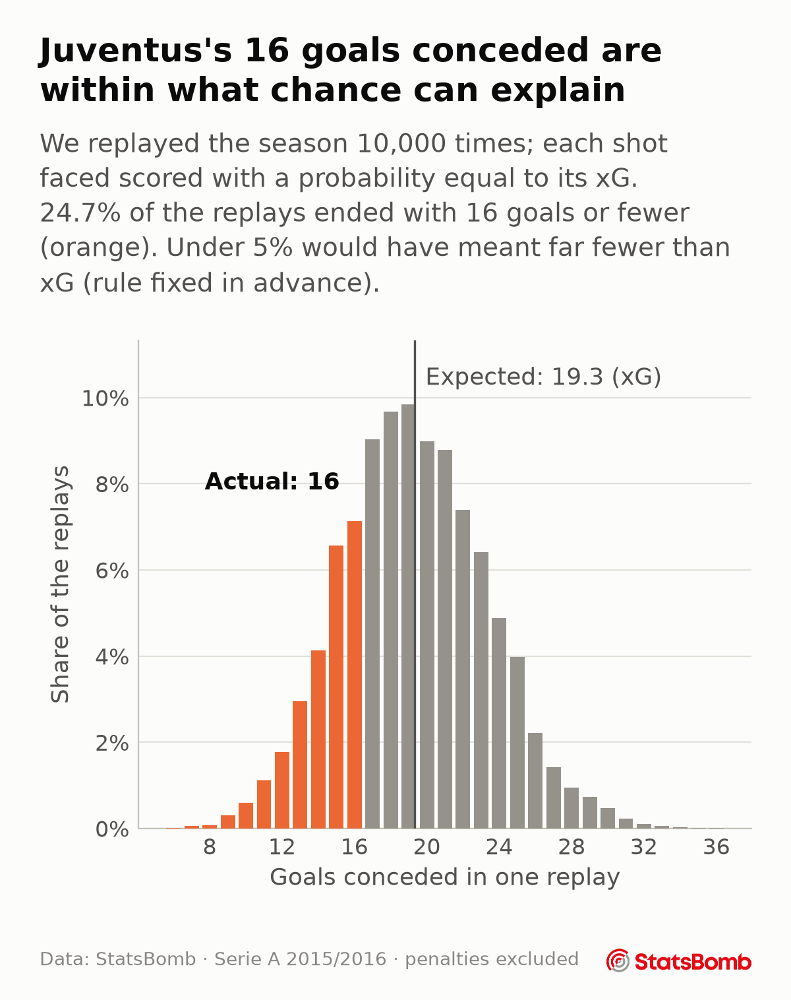

<!-- Written by src/05_report.py from templates/summary_ja.template.md. Do not edit this file: edit the template, then run run_all.py. -->
# ユベントスはなぜ失点が少なかったのか

セリエA 2015/16 · Masaki Takakuwa · データ: StatsBomb

**問い** ユベントスはリーグ戦 38 試合で 20 失点と、20 チームで最も少なかった。なぜか。

**仮説**（分析の前に決めた） 相手に許したチャンスが最も少なく、最も質が低かった。失点は xG の予想どおりだった。つまり理由はゴールキーパーや運ではなく、守り方にある。*（xG＝ゴール期待値: それぞれのシュートがゴールになる確率。StatsBomb のモデルによる）*

**データで確かめた結果**（全 380 試合。判定の基準は結果を見る前に決めた）

- **チャンスの質が最も低い: 支持。** 相手のシュートが平均でゴールになる確率（xG）は 5.6% で、20 チームで最も低い。
- **チャンスの数が最も少ない: 不支持（僅差）。** 被シュートは試合平均 9.1 本で 2 位。ナポリはシーズン全体で 2 本少なかったが、より質の高いシュートを打たれていた（平均 7.1%）。
- **失点は xG の予想どおり: データと矛盾しない。** PK を除くシュートからの失点 16 に対し、xG は 19.3。シーズンを 1 万回やり直すと、24.7% がこの失点以下で終わった。偶然で説明できる範囲。
- **ボール保持が一部を説明。** 相手のボール保持 100 回あたりでは、シュート数が 3 位、xG が 1 位。

 

**結論** 守備は、打たせたシュートや失点の数だけでなく、許したチャンスの質で測る。見出しの数字は要因に分けてから説明する: ユベントスの記録は、とても少ない被シュートと、リーグで最も弱いチャンスの両方から来ていて、運を持ち出さなくても説明できる。

**確かめ方** 分析の前に、データの確認 9 項目すべてに合格した。例: 全試合で、イベントから数えた得点が最終スコアと一致する。データから作り直した順位表が、公式の順位表と一致する。

**限界** 対象はこのシーズンだけで、xG は StatsBomb のモデルによる。「偶然で説明できる範囲」は「運がなかった」ことの証明ではない。イベントデータなので、ボールを持っていない選手の位置は分からない。

コード・データの確認・すべての決定の記録: [github.com/takakuwa-mamada/juventus-defence-2015-16](https://github.com/takakuwa-mamada/juventus-defence-2015-16)。コードは AI のコーディング支援（Claude Code）で書いた。問い・仮説・データの確認・グラフの選び方・解釈は自分のもの。

