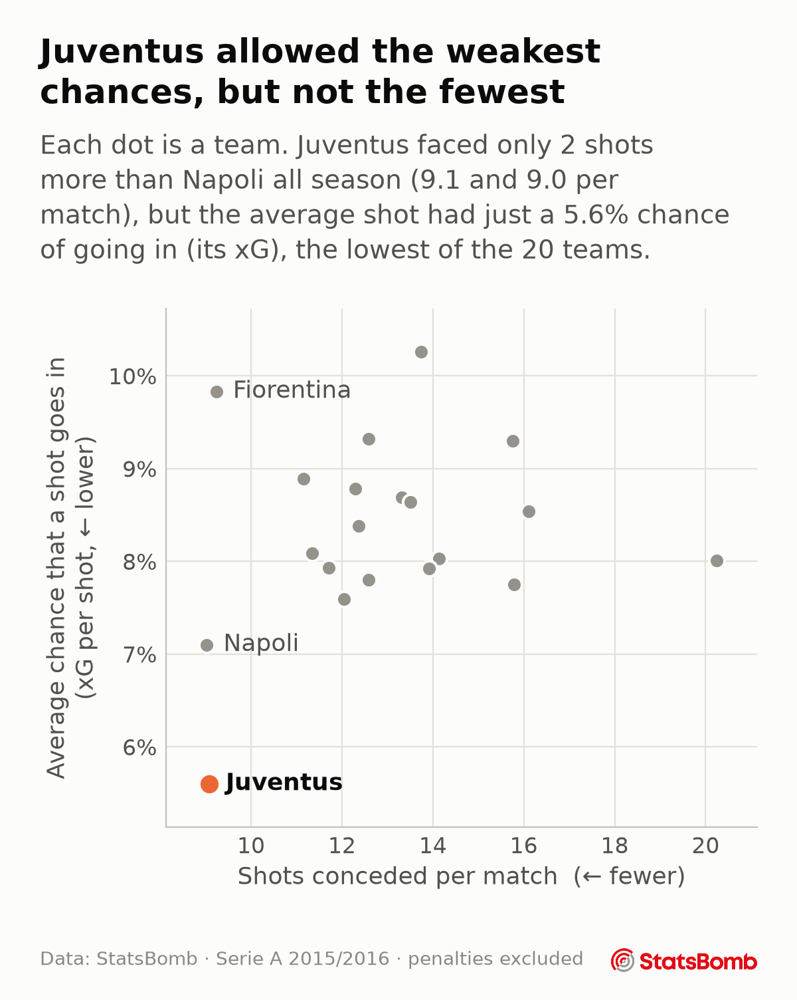
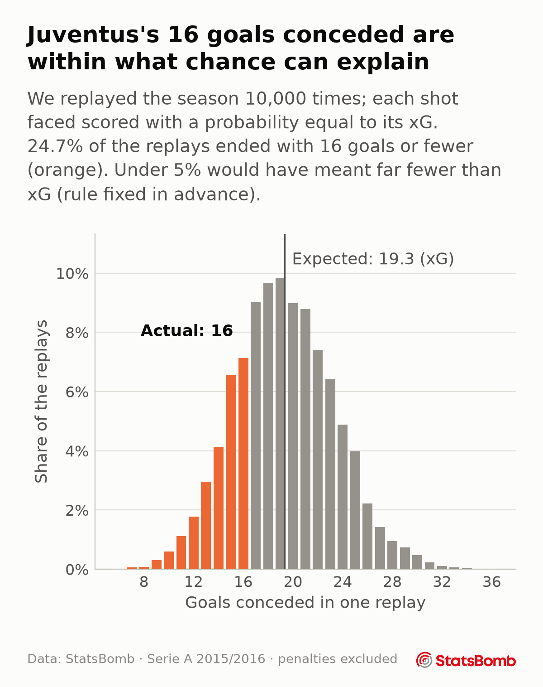

# Why did Juventus concede so few goals?

Serie A 2015/16 · Masaki Takakuwa · Data: StatsBomb

**Question.** Juventus conceded only {{juve_goals_total}} goals in {{matches_per_team}} league matches, the fewest of the {{n_teams}} teams. Why?

**Hypothesis**, written before the analysis: they allowed the fewest and the weakest chances, and their goals conceded were about what xG predicted. So the reason was how they defended, not their goalkeeper or luck. *(xG, expected goals: for each shot, the chance that it becomes a goal, from StatsBomb's model.)*

**What the data shows** (all {{n_matches}} matches; the rules were fixed before the results)

- **The weakest chances: supported.** The average shot against Juventus had a {{juve_xg_per_shot_pct}} chance of going in, the lowest of the {{n_teams}} teams.
- **The fewest chances: not supported, but close.** {{juve_shots_per_match}} shots per match, the {{juve_shots_rank}} fewest. {{fewest_shots_team}} faced {{shots_gap_text}} fewer all season, but more dangerous ones ({{fewest_shots_xg_per_shot_pct}} per shot).
- **Goals about what xG predicted: consistent.** {{juve_goals_from_shots}} goals from non-penalty shots, against {{juve_xg}} xG. In {{n_replays}} replays of the season, {{replay_share}} ended with as few goals or fewer: within what chance can explain.
- **Possession explains part.** Counted per 100 opponent possessions, Juventus is {{juve_shots_per_100_rank}} on shots and {{juve_xg_per_100_rank}} on xG.

 

**So what.** Judge a defence by the quality of the chances it allows, not only by how many shots or goals it concedes. Before explaining a headline number, break it into its drivers: Juventus's record came from very few shots and the weakest chances in the league, and luck is not needed to explain it.

**How it was checked.** Before the analysis, the data passed all {{n_checks}} checks: for example, the goals in the events add up to the final score of every match, and the league table rebuilt from the data matches the official one.

**Limits.** One season and one data provider (xG is StatsBomb's model). "Within chance" is not proof of no luck. Event data shows where the other players were only when a shot was taken.

Code, data checks and every decision: [github.com/takakuwa-mamada/juventus-defence-2015-16](https://github.com/takakuwa-mamada/juventus-defence-2015-16). The code was written with an AI coding assistant (Claude Code); the question, hypothesis, data checks, chart choices and interpretation are mine.

