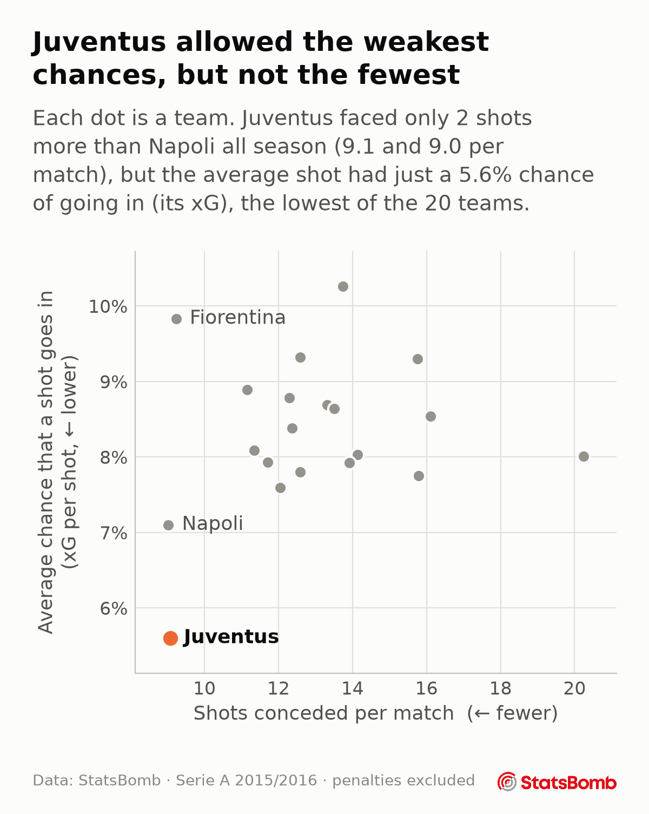
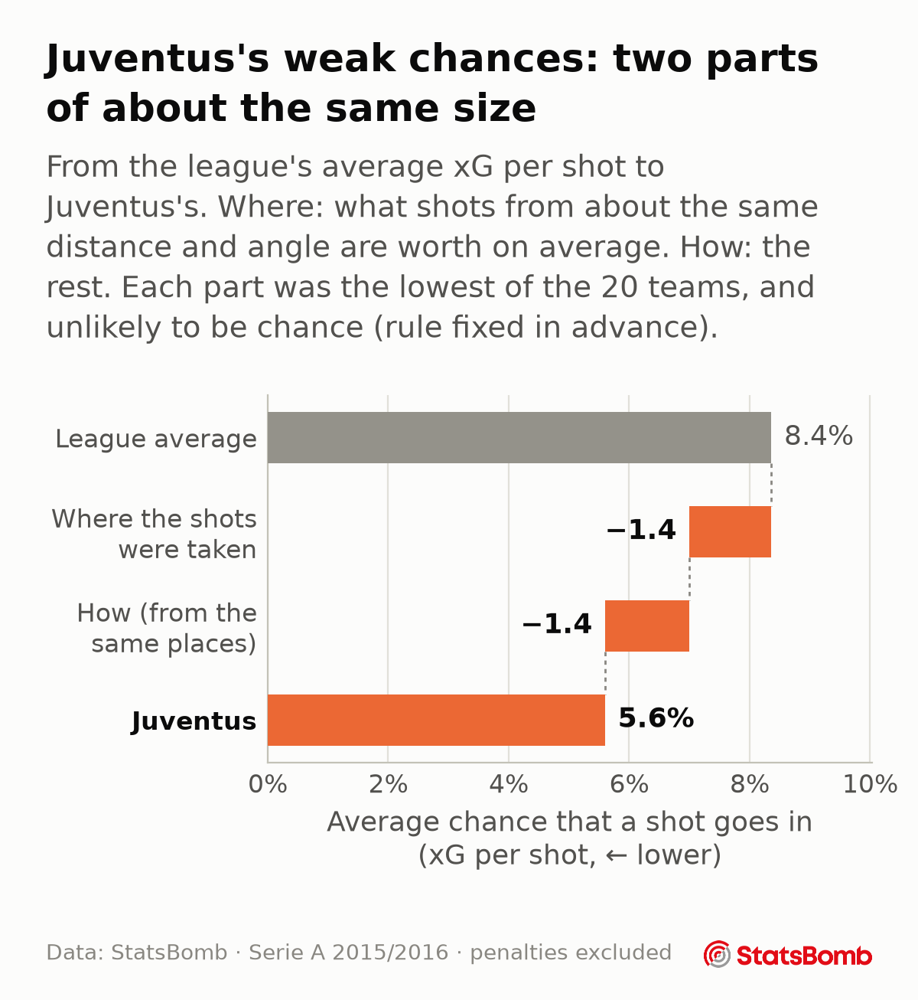

# ユベントスはなぜ失点が少なかったのか

セリエA 2015/16 · Masaki Takakuwa · データ: StatsBomb

**答え: 打たれたシュートが少なく、しかも入りにくかった。** ユベントスは {{matches_per_team}} 試合で {{juve_goals_total}} 失点と、{{n_teams}} チームで最も少なかった（次は{{second_goals_team_ja}}の {{second_goals_total}} 失点）。全 {{n_matches}} 試合のデータで相手に打たれたシュートを調べると、本数は {{juve_shots_rank_n}} 番目に少なく、入る確率（xG）は最も低かった。失点の少なさは、この二つでほぼ説明できる。

*xG（ゴール期待値）: そのシュートが入る確率。打たれたシュートの xG を足すと「見込まれる失点」になる。*

- **打たれた本数は{{fewest_shots_team_ja}}とほぼ同じ。違ったのは入りにくさ。** 打たれたシュートは試合平均 {{juve_shots_per_match}} 本で、最も少ない{{fewest_shots_team_ja}}は {{fewest_shots_per_match}} 本。入る確率の平均は、{{fewest_shots_team_ja}}の {{fewest_shots_xg_per_shot_pct}} に対して {{juve_xg_per_shot_pct}} で、{{n_teams}} チームで最も低い（リーグ平均は {{league_xg_per_shot_pct}}）。
- **失点は見込みより {{goals_below_xg}} 少なかったが、運がよかったとは言えない。** PK を除くシュートからの失点は {{juve_goals_from_shots}} で、見込みは {{juve_xg}}。どのシュートも xG の確率で入るとしてシーズンを {{n_replays_ja}}回やり直すと、約 {{replay_one_in_text}}は {{juve_goals_from_shots}} 失点以下で終わった。
- **打たれた本数が少なかったのは、相手の攻撃回数が少なかったことも一因。** 相手の攻撃 100 回あたりで数え直すと、打たれたシュートの少なさは {{juve_shots_rank_n}} 番目から {{juve_shots_per_100_rank_n}} 番目に下がる。見込まれる失点は、どちらの数え方でも最も少ない。
- **入りにくかった理由の半分は打たせた場所、残り半分は同じ場所でも入りにくかったこと。** 同じ距離・角度から打たれたリーグのシュートなら、入る確率の平均は {{juve_place_xg_per_shot_pct}}（リーグ平均より {{where_points}} ポイント低い）。実際はそこからさらに {{how_points}} ポイント低かった。どちらの差も {{n_teams}} チームで最も大きく、偶然では {{where_how_chance_text}}ほどしか起きない。
- **同じ場所でも入りにくかった理由は、まだ大半が分からない。** シュートコース（ボールと両ゴールポストを結ぶ三角形）にいた守備の人数は、同じ場所から打たれたリーグのシュートより多くなかった（多い順に {{n_teams}} チーム中 {{defenders_rank_n}} 番目）。ヘディング・プレッシャー・最後のパスの種類で説明できたのも {{kinds_share}} だけで、結果を見る前の予想（{{kinds_expected_pct}} 以上）は外れた。

 

**確かめ方** 仮説と判定の基準は、結果を計算する前に GitHub に記録した。仮説のうち「打たれたシュートが最も少ない」は外れた（{{juve_shots_rank_n}} 番目）。データは、分析の前に {{n_checks}} 項目の確認すべてに合格した（例: データから作り直した順位表が公式と合う）。

**限界** 対象は一シーズンだけで、xG は StatsBomb のモデルの値。運がよかったとは言えなくても、運が関係なかったとは限らない（失点が {{far_fewer_max_goals}} 以下でないと、見込みよりはっきり少ないとは判定できない）。選手の位置が分かるのは、シュートの瞬間だけ。「同じ場所でも入りにくかった」分には、GK の位置や打ち方など、場所以外のすべてが入る。

コード・データの確認・すべての決定の記録: [github.com/takakuwa-mamada/juventus-defence-2015-16](https://github.com/takakuwa-mamada/juventus-defence-2015-16)。コードは AI（Claude Code）が書いた。問い・仮説・データの確認・図の選び方・解釈は自分で決めた。

